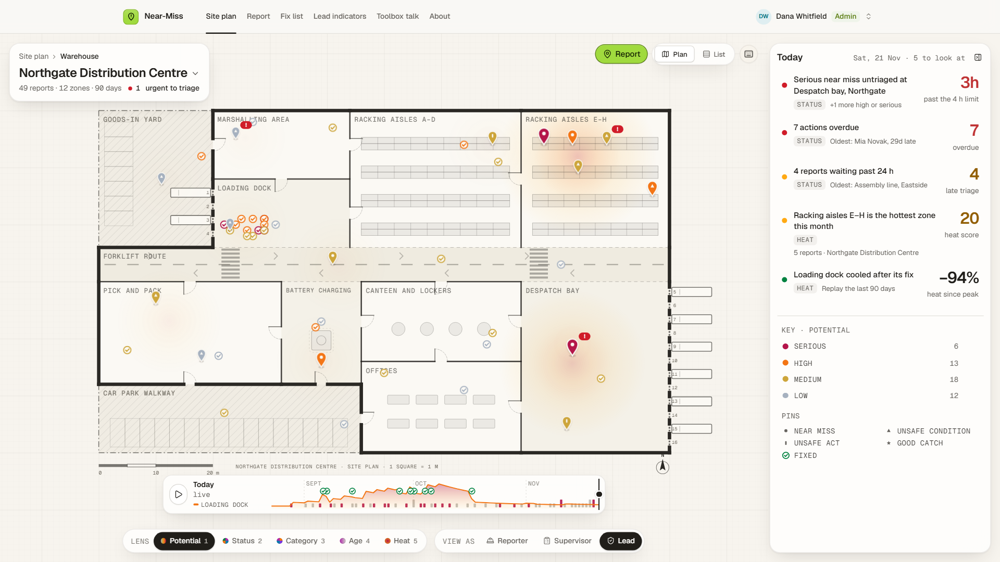

# Near-Miss

Report a hazard or near miss in about 30 seconds from a phone, with the option to keep your name off it. Supervisors
triage and assign fixes, and **the site plan** shows every report as a pin on an architectural drawing of the site,
with heat blooming where hazards cluster, so they get fixed before someone gets hurt.




## This repository

```text
apps/near-miss/   the app: React + Vite frontend, Rayfin data model (rayfin/), tests, demo walkthrough
shared/         shared package (@x10/shared): data store, sign-in runtime, UI kit, charts
tools/          deploy, seed, SQL and secrets-check scripts
```

Quick start (no Fabric tenant needed, runs in demo mode with sample data):

```bash
npm install
npm run dev
```

## The problem, and what it supports

Most serious workplace injuries are preceded by near misses and unsafe conditions that someone saw and did not report:
reporting is slow, on paper, or feels like getting a colleague in trouble. Safety teams then manage by lagging
indicators (injuries) instead of leading ones (hazards found and fixed).

Near-Miss supports the hazard identification, worker participation and incident follow-up parts of an occupational
health and safety management system such as ISO 45001: anyone can report without fear of reprisal (anonymously if they
want), every report is triaged against a clock, serious ones cannot be closed without an owned action, and fixes are
tracked to verified completion. It supports the process; it is not legal, compliance or safety advice and does not
replace a competent person's risk assessment or any legal duty to report injuries to a regulator.

## What it looks like

**The site plan.** Each site is drawn as a clean architectural plan generated from its zones: rooms and yards, exterior
and interior walls, door swings, racking, machine bases, desks, vehicle routes with centre lines, zebra crossings and
numbered dock doors with trailers. Every report of the last 90 days is a pin that drops in where it happened, coloured
by the lens; fixed hazards shrink to a small check mark; untriaged high and serious reports pulse. A heat layer blooms
over hotspots, and a **90-day time slider** replays the plan day by day (pins appear when reported, statuses and heat
as they were that day), so you can watch the loading dock hotspot form and cool after its fix.

- **Lenses (1–5):** potential, status, category, age, heat (with the top three hotspots ranked on the plan).
- **View as (V):** reporter (your own pins ringed, others dimmed, your reports in Today), supervisor (your site's
  queue), safety lead (every site, stronger heat).
- **Today:** 3–5 ranked items that focus the plan: serious or high reports past their triage time, overdue actions,
  late triage, the hottest zone this month, a hotspot that cooled after its fix (replays it), good catches to thank.
- **Tools named for the job:** **Report** (the 30-second phone form: tap the zone on the plan, category chips,
  potential, one sentence, anonymous switch, send), **Toolbox talk** (a printable one-page zone briefing),
  **Fix list** (actions by owner and due date), **Lead indicators** (the leading-indicator charts by site).
- **Fallbacks:** the list view (L) shows the same reports as a table that prints; the plan is SVG, so it needs no WebGL
  (`?nowebgl` is tested); `prefers-reduced-motion` turns off the pin drop, heat bloom and camera moves; keyboard
  shortcuts on `?`; the toolbox talk is the print path.

## Prerequisites

- Microsoft Fabric with the Fabric Apps workload enabled for your tenant.
- A Fabric workspace on a capacity (F2 or larger; see `shared/NOTES.md` on sizing if you deploy several apps).
- Edit permission (Contributor or above) on that workspace to deploy.
- Node.js 20 or later.
- Everyone who reports needs access to the app item (workspace members get it by default). Shop-floor staff without
  Fabric access need to be added as workspace members or guests before they can report.

## Run locally

```bash
npm install            # at the repo root (npm workspaces)
cd apps/near-miss
npm run dev            # demo mode on http://localhost:5220: in-memory data, seeded, persona switcher
npm run dev:fabric     # against a deployed backend through the Rayfin CLI (after `npx rayfin login`)
```

Demo personas (identity menu, or `?as=<sub>`): Dana Whitfield (safety lead, admin, supervises Harbour Office),
Priya Raman (supervisor, Northgate), Tom Okoro (supervisor, Eastside), Sam Taylor (operator, reporter).

Tests: `npx tsc -b`, `npx vitest run`, `npx playwright test` (390 px and 1280 px). Screenshots:
`SHOTS=1 npx playwright test e2e/screens.spec.ts --project=desktop` writes `docs/redesign/`.

## Deploy

```bash
npx rayfin login
npx rayfin up --workspace-id <workspace-id>
```

`rayfin up` builds the app, creates the SQL database and GraphQL API, applies the schema and row policies, and uploads
the static site.

## Seed and make an admin

```bash
npm run seed:fabric -- --admin-email you@yourorg.com
```

Open the app once first so your Person row exists. The script loads the demo sites, zones, reports and actions
(skipped if already seeded) and sets `isAdmin = 1` on your Person row, mapping you onto the safety lead persona, who
also supervises Harbour Office so you can triage straight away. The manual equivalent in the Fabric SQL editor:

```sql
UPDATE dbo.People SET isAdmin = 1 WHERE email = 'you@yourorg.com';
```

Sites and zones are set up with SQL (there is no client write access to them; see the security model). To make a
colleague a site's supervisor: `UPDATE dbo.Sites SET supervisorSub = '<their sub>', supervisorName = '<name>' WHERE name = '<site>';`
(their `sub` is in `dbo.People` once they have opened the app).

## How it works

| Entity | Fields (abridged) | Notes |
|---|---|---|
| Site | name (3–80), kind, supervisorSub, supervisorName | Read-only through the API |
| Zone | siteId, name (≤ 60), kind (room, yard, dock, store, route, plant, office, welfare), x, y, w, h on a 100 × 60 grid | `kind` decides how the plan draws it; read-only |
| Report | siteId, zoneId, kind, category, potential, description (10–1000), immediateAction (≤ 500), anonymous, reporterSub?, reporterName?, reportedAt, status, triagedBy/Name/At, fixedAt, closedAt, x, y | Anonymous rows have no reporter fields at all |
| Action | reportId, siteId, title (3–150), ownerSub, ownerName, dueAt, status (open, done), doneAt, verification (≤ 300), createdBySub, createdAt | Overdue is computed |
| Person, AppMarker | as generated | |

**Rules** (pure functions in `src/domain/rules.ts`, `hotspots.ts`, `indicators.ts`, `today.ts`, unit-tested; thresholds
in `src/config.ts`):

1. Triage within 24 hours; high or serious potential within 4 hours. Late triage shows in Today.
2. A serious report cannot move past triaged (to action assigned, fixed or closed) without an action.
3. Action due dates default by potential: serious 2 days, high 7, medium 14, low 30.
4. Hotspots rank zones by a weighted count of reports over 90 days: serious 8, high 4, medium 2, low 1. Live heat on
   the plan uses the same weights, halves every 14 days and drops to 20% once a report is fixed.
5. Leading indicators: reports per month, % of actions done by their due date, median days to fix, good catches.

Anonymity: when anonymous is chosen, `reporterSub` and `reporterName` are not sent or stored (the create payload omits
them), so nobody, including admins and anyone with database access, can see who reported. The reporter is told in the
form that they cannot edit it afterwards. Named reports can be edited by their reporter while new.

**Security model** (row policies on the entities, plus checks in `src/domain/reports.ts` that hold in demo and Fabric
mode):

| Entity | Row policy | Enforced in the domain as well |
|---|---|---|
| Site, Zone | read only (no create, update or delete for anyone through the API) | — |
| Report | read: authenticated. create: `(claims.sub = reporterSub and anonymous = false) or (anonymous = true and reporterSub is null and reporterName is null)`, and `status = 'new'`; triage and fix fields excluded. update: any signed-in user, but `siteId`, `anonymous`, `reporterSub`, `reporterName`, `reportedAt` excluded. delete: nobody | Only the site's supervisor or the safety lead triages, assigns, fixes and closes; the reporter edits only their own named report while new; anonymous reports cannot be edited; rule 2 |
| Action | read: authenticated. create: `claims.sub = createdBySub and status = 'open'`, completion fields excluded. update: `claims.sub = ownerSub`, only `status`, `doneAt`, `verification`. delete: nobody | Only the supervisor or safety lead assigns; owner-only completion; the last action done marks the report fixed |
| Person | as generated (own row; `isAdmin` excluded from client writes) | — |

## Known limits

- **Report updates have no row check.** The policy DSL cannot say "the site's supervisor or the safety lead" (there is
  no admin claim, and the supervisor lives on Site), and an owner-only policy would lock supervisors out of triage. So
  a user calling the GraphQL API directly can change any report's description, category, potential, zone, pin
  position and status fields. The app enforces who may change what in `src/domain/reports.ts`. Closing this at the
  database needs dynamic auth claims (`udf.authClaims`) or a server function.
- **The anonymous create policy relies on `eq null`.** The DSL compiles `item.reporterSub.eq(null)` to
  `@item.reporterSub eq null`, which Data API Builder translates to `IS NULL`. Verify after the first deploy that an
  anonymous report saves; if your DAB version rejects it, drop the null checks from the create policy (the domain
  still never sends reporter fields on an anonymous report).
- **Back-dating.** `reportedAt` is set by the client, so a direct API caller could file a report with an old date.
  The app always writes the current time.
- **Owners are not checked on create.** A supervisor (through the API) could assign an action to any `ownerSub`; the
  app only offers people who have opened it.
- **Site supervisor changes** are SQL-only, and reports keep their site's current supervisor (looked up live).
- Fabric caps one page of results at 100 rows; the shared store pages through larger tables.

## Later

Photos on reports (needs file storage); SMS or QR-code reporting at the zone; an incident (injury) module linked to
the near misses that preceded it; a site and zone editor for the safety lead; push notifications for urgent triage.

## Gallery

**Title:** Birthday Bash: Near-Miss

**Blurb (74 words):** Report a hazard in 30 seconds, fix it before anyone gets hurt, and see where the risks cluster.
Near-Miss draws each site as an architectural plan: every near miss and good catch is a pin, and heat blooms over
hotspots. Replay 90 days to watch a hotspot form and cool after its fix. Report anonymously with nothing stored about
you, triage serious reports within four hours, assign fixes, print a toolbox talk and track leading indicators.

**Tags:** Partner | Birthday Bash, Health and safety, Near miss reporting, ISO 45001, Fabric Apps, SQL database

## License

MIT. See [LICENSE](LICENSE).
